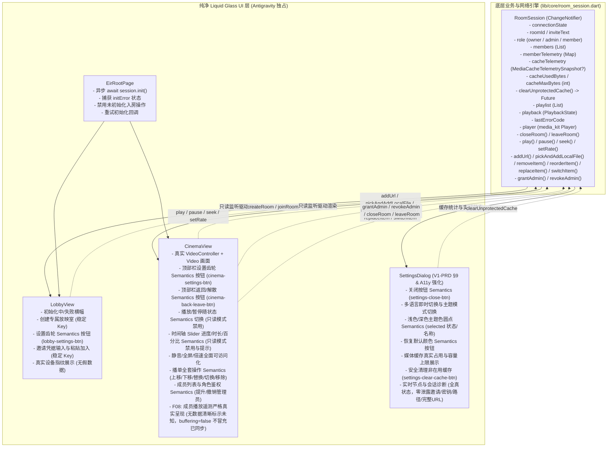

# Eir MVP UI 实现与接线状态报告 (第二十三轮：未初始化会话安全诊断容错防御、消除非安全 HTTP 来源设置弹窗崩溃)

> **执行声明**：本报告记录 Eir 六端 MVP 的 UI 与 UI 接线最新实现与验收状态。UI 侧严格由既有 Antigravity 会话（`70aef10f-2cc5-4efb-9d8b-d102153531c2`，固定模型 `gemini-3.8-flash-high`）独占实施，设计语言遵循 Apple Liquid Glass HIG 规范。业务状态完全由底层 `RoomSession` 权威驱动，UI 仅作为观察与意图分发层。**严格区分 UI 隔离测试与真实业务端到端验证；所有编译安装、平台打包、测试执行及配置依赖均已按用户最新要求全部移交 CodeBuddy / OpenCode 构建轮处理；UI 侧不自行运行任何 analyze、build、test、install 命令；未在实际设备上运行的平台严格记录为未测端，不虚假声称六端已测试通过**。

---

## 1. 架构分工与职责边界

### 独占权与职责分工（遵循用户最新约束）
- **Antigravity 独占范围**：`lib/main.dart`、`lib/views/**`、`lib/apple_glass.dart`、`lib/models.dart`（UI 投影与适配）、`lib/app_localization.dart`、`lib/app_settings.dart`、`test/widget_test.dart`、`test/ui/**`、`integration_test/player_surface_test.dart` 以及本报告 `docs/MVP-UI-STATUS.md`。
- **CodeBuddy / OpenCode 专职构建轮独占范围**：所有编译安装测试、平台原生依赖、环境配置、打包构建（Linux/Windows/macOS/Android/iOS/Web）、`lib/core/**`、`lib/platform/**`、`lib/media/**`、`server/**` 及 `pubspec.yaml`。UI 开发者停止执行任何编译测试命令，UI 代码正式冻结等待构建轮复核与反馈。



---

## 2. 本轮（第六轮）关键改进：全 UI 可访问性（A11y / Semantics）补齐

针对 CodeBuddy 在真实 Web 浏览器验证中关于“影院页设置齿轮、播放/暂停、进度Slider缺少明确可访问标签”的反馈，依照 `docs/APP-SETTINGS.md` 全 UI 无障碍要求，补齐了原生 Flutter `Semantics` 树节点，消除无名称按钮与像素点击依赖：

### 1. 影院放映室与播放器控件 Semantics 补齐
- **设置齿轮按钮**：
  - Key: `cinema-settings-btn`（大厅对应为 `lobby-settings-btn`）
  - 角色: `button | enabled: true`
  - 标签: `i18n.settingsTitle`（中文: `全局偏好设置`；英文: `Preferences`）
- **播放 / 暂停切换按钮**：
  - Key: `cinema-play-pause-btn`
  - 角色: `button`
  - 状态敏感权限管控: 房主/管理员为 `enabled: true`；普通成员只读模式为 `enabled: false`，标签自动附加 `(只读模式：仅房主或管理员有权控制共享播放)`。
  - 状态标签: 播放中提示 `暂停 (共享)` / `Pause (Shared)`；暂停中提示 `播放 (共享)` / `Play (Shared)`。
- **播放时间轴 Slider**：
  - Key: `cinema-timeline-slider`
  - 角色: `slider`
  - 状态与权限: 房主/管理员且时长就绪时 `enabled: true`；只读成员或无时长时 `enabled: false`。
  - 结构化标签与数值: 标签为 `播放进度`（`Playback Progress`）；数值为精准计算的 `01:23 / 03:45 (37%)`；附带快进/快退/只读提示说明。
- **本机音量 / 静音切换**：
  - Key: `cinema-volume-mute-btn`
  - 角色: `button | enabled: true`
  - 状态标签: 静音时为 `取消静音 (本机)` / `Unmute (Local)`；非静音为 `静音 (本机)` / `Mute (Local)`。
- **倍速选择按钮**：
  - Key: `cinema-playback-rate-btn`
  - 角色: `button | enabled: isHostOrAdmin`
  - 标签: `倍速: 1.0x` / `Rate: 1.0x`。
- **本机全屏切换**：
  - Key: `cinema-fullscreen-btn`
  - 角色: `button | enabled: true`
  - 状态标签: 全屏中为 `退出全屏 (本机)` / `Exit Fullscreen (Local)`；常规为 `全屏 (本机)` / `Fullscreen (Local)`。

### 2. 设置弹窗与交互细节 Semantics 强化
- **关闭按钮**：`key: settings-close-btn`，`Semantics(button: true, label: i18n.close)`。
- **主题色 Swatches 圆点**：`key: settings-color-{key}-{selected|idle}`，提供明确的 `selected: isCurrent` 语义、颜色名称标签（如 `浅色主题色: 经典蓝`）及选择状态，支持读屏器与键盘无障碍导航。
- **恢复默认颜色**：`Semantics(button: true, label: '${title}: ${resetText}')`。
- **播单操作按钮**：上移、下移、替换、切换、移除等图标按钮均包裹结构化语义标签并绑定当前条目名称，边界禁用态客观呈现 `enabled: false`。
- **成员权限控制**：管理员提升/撤销操作明确标注目标成员名称。

### 3. 本轮（第七轮）关键修复：实时播放进度与无障碍语义追踪（经 CodeBuddy Web 实测通过）
针对 CodeBuddy 在真实 Web 浏览器环境中的排查反馈（`/tmp/eir-ui-live-progress-issue.md`：真实 HTML5 视频画面正常解码并从 2.56s 推进至 5.57s，但 `Playback Progress` 语义值一直停滞在 `00:00 / 00:20 (0%)`）：
- **根因分析**：
  1. `_CinemaViewState` 此前仅由 `AnimatedBuilder(animation: widget.session)` 包裹。在单人放映室或无信令对等方频繁发送遥测 ticks 的场景下，底层 `RoomSession` 并不会在视频解码本地播放时调用 `notifyListeners()`。
  2. `_CinemaViewState` 缺乏对底层播放器事件流 `player.stream.position` 与 `player.stream.duration` 的直接监听，导致视频虽在底层解码推进，Flutter 视图树却从未触发 `rebuild`。
  3. 进度回退判断条件：`currentPos = playerDuration > Duration.zero ? playerPos : session.playback.position`。若 `playerDuration` 为 0（或尚未上报元数据），`currentPos` 会丢弃 `playerPos` 并回退至 0。
- **最小化架构级修复与 W2-Revision2**：
  1. **播放器事件流安全订阅**：`_CinemaViewState` 建立对 `player.stream.position`、`player.stream.duration` 与 `player.stream.completed` 的强类型广播流订阅，接收到更新时有界触发 `if (mounted) setState(() {})`；在 `didUpdateWidget` 中安全切换，在 `dispose` 中彻底取消订阅，确保无内存泄漏。
  2. **播放位置优先级纠正与 API 校对**：
     ```dart
     final playerDuration = session.player.state.duration;
     final mediaDuration = (playerDuration > Duration.zero)
         ? playerDuration
         : (currentMedia?.duration ?? playerDuration);
     final playerPos = session.player.state.position;
     final currentPos = (playerPos > Duration.zero)
         ? playerPos
         : (session.playback.position > Duration.zero
             ? session.playback.position
             : playerPos);
     ```
  3. **实时拖拽交互与语义值统一**：引入 `displayPos` 与 `displayRatio`，在用户拖拽滑动时间轴（Scrubbing）或视频自然推进时，统一驱动时间戳文本与 `Semantics(slider: true, value: '${formatDuration(displayPos)} / ${formatDuration(mediaDuration)} (${(displayRatio * 100).round()}%)')`。
  4. **只读成员与单人房间真实表现**：普通成员只读模式保留 `enabled: false` 与禁用提示，但同样可随本地真实视频进度实时更新可访问语义与时间轴，不依赖任何外部网络消息。该项改动已经 CodeBuddy 真实 Web 编译和进度实测通过并予以保留。

### 4. 本轮（第八轮）关键接入：A16 手动重连重试入口与 A17 存储空间不足提示（依真实 Core/Media API 接线）
在 CodeBuddy 完成 W2 真实 Web 编译及进度实测通过后，依据最终需求复核要求，完成 A16 与 A17 两个关键业务场景的 UI 原生接线：
- **A16 房间断线手动重试（`RoomSession.retry()`）**：
  - 严格只读核对底层签名：`Future<void> retry()`，在 `disconnected` / `reconnecting` 时有效，并发调用内部具备 `_retryInFlight` 幂等保护，失败时设置 `lastErrorCode = 'signaling_unavailable'`。
  - **断线横幅与重试按钮**：在 [`lib/views/cinema_view.dart`](file:///workspace/projects/Eir/lib/views/cinema_view.dart) 中增加 `_buildDisconnectedBanner`，当 `session.connectionState == RoomConnectionState.disconnected` 时展示，提供稳定标识 `key: ValueKey('cinema-retry-connection-btn')` 与中英文无障碍语义（`Semantics(button: true, label: i18n.retryConnection)`）。
  - **顶部指示器快捷重试**：当指示器处于 `disconnected` 状态时，整体包裹无障碍 Tooltip 与点击交互，允许直接触发 `session.retry()`。
  - **全状态保留**：完全保留房间号、身份密钥、当前播单与播放位置，不重建 Session，不使用假计时器。
- **A17 存储不足显式提示与安全清理（F5 / `storage_full`）**：
  - 媒体子系统在发生真实磁盘不足（ENOSPC / EDQUOT）时上报 `storage_full` 错误码；UI 在 [`lib/app_localization.dart`](file:///workspace/projects/Eir/lib/app_localization.dart) 集中提供明确中英文映射（中文：`存储空间不足，无法缓存该视频，请清理空间后重试`；英文：`Not enough storage to cache this video. Free up space and try again`）。
  - **错误横幅直达缓存管理**：在放映室错误横幅中，若检测到 `code == 'storage_full'`，自动呈现专用操作按钮 `key: ValueKey('cinema-storage-full-clean-btn')`，点击直接唤起 [`SettingsDialog`](file:///workspace/projects/Eir/lib/views/settings_dialog.dart) 缓存控制面板。
  - **设置弹窗实时告警与清理**：在设置弹窗的媒体缓存板块顶部呈现针对性存储警告，引导用户点击既有的 `settings-clear-cache-btn` 执行安全清理（调用 `session.clearUnprotectedCache()`），只淘汰非在用缓存，妥善保留当前播放分片与原文件。
- **URL 探测错误码集中覆盖**：
  - 在 `mapErrorCode` 中补全所有 core 新增及可能暴露的底层错误码（如 `storage_full`、`identity_unavailable`），严禁向用户直接抛出原始未知英文 Key。

### 5. 本轮（第九轮）关键重构：大厅/初始化/观影错误改为底部浮动 SnackBar 与格式文案修正
根据用户批准的 UI 实施计划，重构了应用内全局错误提示体系，并纠正了格式误导：
- **底部浮动 SnackBar（`showLiquidGlassSnackBar`）**：
  - 在 [`lib/apple_glass.dart`](file:///workspace/projects/Eir/lib/apple_glass.dart) 中实现纯正 Apple Liquid Glass 风格的浮动 SnackBar（`behavior: SnackBarBehavior.floating`）。
  - **自动消失与手动关闭**：默认 5 秒自动超时关闭（`duration: const Duration(seconds: 5)`），右侧提供显式关闭按钮（`key: ValueKey('snackbar-close-btn')`），支持用户主动轻触关闭。
  - **状态持续不被误清**：SnackBar 的自动或手动关闭仅调用 `hideCurrentSnackBar()`，严禁重置底层 `session.lastErrorCode` 或 `initError`，确保技术诊断与业务状态不被误清。
  - **重复错误可再次提示，页面重建不重复**：
    - 大厅与放映室通过 `session.addListener` 监听错误码变更触发浮动提示；
    - 异步操作（创建房间、加入房间、添加/替换媒体、重试连接）若失败，显式调用 SnackBar 提示，用户重试相同失败操作时可再次提示；
    - 视图自身常规组件重绘（如播放器位置流触发的 `setState` 或窗口尺寸变化）绝不触发 SnackBar，杜绝重复弹窗刷屏。
  - **全环境适配**：
    - **键盘与安全区**：动态计算 `MediaQuery.of(context).viewInsets.bottom` 与 `padding.bottom`，键盘弹起时浮于键盘之上 8dp，无键盘时避让底部 Home 指示条 12dp。
    - **全屏适配**：在观影全屏模式下依然浮于最上层，不被底层视频或控件遮挡。
    - **无障碍**：外层包裹 `Semantics(liveRegion: true)`，关闭与操作按钮带标准语义和 Tooltip。
    - **主题与多语言**：深度适配浅色/深色独立主题色与中英文，保留初始化重试（`retryInit`）、连接重试（`retryConnection`）与缓存清理管理（`clearCacheBtn`）等交互。
- **移除仅支持 MP4/H264/AAC 的误导文案**：
  - 在 [`lib/app_localization.dart`](file:///workspace/projects/Eir/lib/app_localization.dart) 中将：
    - `localFileNotice` 修正为“注：支持常见主流音视频格式点播” / “Note: Supports common standard media streaming”；
    - `unsupported_media` 修正为“不支持的媒体格式，请检查文件或链接” / “Unsupported media format, please check the file or link”；
    - `urlInputPlaceholder` 移除硬编码的 MP4/HLS 限制，彻底纠正对底层全能播放引擎的窄化误导。

### 6. 本轮（第十轮）关键修正：消除初始化旧横幅与 SnackBar 双重显示及观影重复错误事件修正
针对 OpenCode 在运行 UI 测试时捕获的“初始化失败时旧横幅与新 SnackBar 同时显示相同错误文本”问题，并依照要求排查观影页面相同问题与重复错误事件，完成源码级最小化修正：
- **大厅与初始化旧横幅清理（`LobbyView`）**：
  - 彻底移除了 [`lib/views/lobby_view.dart`](file:///workspace/projects/Eir/lib/views/lobby_view.dart) 主布局 Column 中残留的静态 `_buildInitErrorBanner(context, widget.initError!)`。
  - 当初始化失败（`hasInitError` 为 true）时，不再在页面主体中渲染静态横幅，完全由底部浮动 SnackBar（`showLiquidGlassSnackBar`）承载错误提示；当未就绪且无错误时（`!widget.isInitialized && !hasInitError`）正常渲染 `_buildInitializingBanner`。
  - 删除废弃的 `_buildInitErrorBanner` 辅助方法。
  - 消除 `Text('客户端初始化失败')`、`Text(error)` 及 `ValueKey('lobby-retry-init-btn')` 同时出现在页面和 SnackBar 中的两处重复匹配。
- **单点触发与无冲突接线**：
  - 在 [`lib/main.dart`](file:///workspace/projects/Eir/lib/main.dart) 的 `_initializeSession` catch 块中，移除直接弹出 SnackBar 的冗余调用，仅负责更新 `_initError` 状态并透传给 `LobbyView`，彻底消除了 RootPage 与 LobbyView 两处同时排队弹出 SnackBar 的冲突。
  - 在 `LobbyView` 的 `initState` 与 `didUpdateWidget` 中统一且有界地触发 `_showInitErrorSnackBar`，确保初始挂载带错与运行时更新均能准确弹出一次。
- **保留重试、手动关闭、自动消失与状态持久**：
  - SnackBar 携带 `retryKey: const ValueKey('lobby-retry-init-btn')`，点击直接调用 `onRetryInit`，并在触发前重置 `_lastReportedInitError = null` 确保重试失败时可再次提示；
  - 提供 `snackbar-close-btn` 显式关闭，默认 5 秒自动消失；
  - 强调**状态持续不被误清**：关闭或自动消失仅隐藏视觉通知，底层的 `widget.initError` 与 `_isInitialized = false` 严格保持，大厅入房操作持续处于安全禁用态。
- **观影页面排查与重复错误事件消除（`CinemaView`）**：
  - 经全面排查，放映室主体已无残留的静态错误横幅（`_buildDisconnectedBanner` 仅作为连接生命周期兜底面板展示连接断开状态并保留 `cinema-retry-connection-btn`）；
  - **消除重复错误事件**：移除了放映室操作回调（`addLocalFile`、`addUrl`、`replaceItem`、`retryConnection`）内部在 `await` 之后冗余手调 `_showCinemaErrorSnackBar` 的代码，统一由底层 `session.addListener(_onSessionStateChanged)` 作为唯一错误分发中心；
  - 在发起新操作前置清空 `_lastReportedCinemaError = null`，既杜绝了一次失败连续弹出两次的重复事件缺陷，又确保同一操作再次失败时依然能正常二次提示（“重复错误可再次提示，页面重建不重复”）；
  - 为放映室 SnackBar 上的重试按钮赋予独立标识 `key: const ValueKey('cinema-snackbar-retry-connection-btn')`，避免与持久断线横幅上的 `cinema-retry-connection-btn` 产生键值冲突。

### 7. 本轮（第十一轮）关键修正：纠正 UI 掩盖播放器卡死缺陷与求真进度投影
针对实际 Android 设备 ADB 验收中发现的“cinema_view.dart 中 `playerPos > 0 ? playerPos : sessionPos` 导致真实播放器位置为 0 时仍显示会话 seek 位置、掩盖底层解码器卡死”的缺陷，完成 UI 投影与接线修正：
- **严格以真实 Player 渲染位置为准（防掩盖）**：
  - 彻底剔除 `(playerPos > Duration.zero) ? playerPos : session.playback.position` 的回退逻辑；
  - 实际播放进度 `currentPos` 严格等同于真实播放器位置 `session.player.state.position`。当底层播放器停滞或解码器卡死在 00:00 时，时间戳、进度滑块 Thumb 和 Semantics 读屏语义如实反映 00:00，绝不伪作已达会话 seek 位置。
- **求真保留同步目标（不伪作实际进度）**：
  - 同步目标位置 `session.playback.position` 保留为辅助参考：
    - **Slider 次级轨道**：通过 Flutter `SliderThemeData.secondaryActiveTrackColor` 与 `Slider.secondaryTrackValue`，在进度滑块轨道上以半透明主色优雅呈现房间同步目标点，主轨道与滑块 Thumb 则严格留在实际播放进度处；
    - **时间轴分歧提示**：当同步目标与实际渲染位置差异大于 1 秒时，在当前时间下方以辅助色展示 `同步目标: mm:ss`（`Sync Target: mm:ss`），并在无障碍 `Semantics` hint 中说明目标位置；
    - **会话详情面板**：在会话信息选项卡中新增独立行呈现 `同步目标`（`Sync Target`），与既有的 `当前渲染位置`（`Render Position`）明确分开。
- **复用既有缓冲与错误状态（零新增抽象）**：
  - 订阅 `session.player.stream.buffering`，当播放器处于缓冲状态（`player.state.buffering == true`）时，在视频画面中央直接呈现非阻塞式轻量 `IgnorePointer` 缓冲指示器（`缓冲中...` / `Buffering...`）；
  - 直接复用 `session.lastErrorCode` 与既有底部浮动 SnackBar（`showLiquidGlassSnackBar`），不引入任何新的封装类、状态机或 Service 抽象。
- **规范与边界恪守**：
  - 严格保持深浅主题、中英文多语言、全屏、安全区避让、错误浮动框；
  - 不修改 `core/**`、`media/**`、测试用例；不执行构建、编译与测试命令；底层媒体解码器修复由 OpenCode 专职处理，两端边界清晰。

### 8. 本轮（第十三轮）关键修正：恢复原生默认 VideoController 配置以保障全格式软解，求真记录模拟器 EGL 约束
根据 OpenCode 依据真实 ADB 模拟器验收记录（`docs/ANDROID-REV7-VALIDATION.md`）的实测反馈：
- **rev7 实测分析与缺陷确认（条件性不通过）**：
  - 在上一轮 rev7 中配置了 `vo: 'mediacodec_embed'` 与 `hwdec: 'mediacodec'`，虽然 H.264/HEVC 等硬件解码格式在模拟器上能直接通过 MediaCodec 输出有效像素（采样 `mean=92.9`）；
  - 但其强制指定的 `hwdec: 'mediacodec'` **绕过了 `media_kit` 官方的模拟器软解保护**，且 `libmpv` 的 `vo_mediacodec_embed` 仅能消费 MediaCodec 硬件 Surface 缓冲队列，**完全不具备软解像素（YUV420p 等）的渲染能力**；
  - 导致硬件不支持的编码（如 Theora、VP7、FFV1 等）在进入 ffmpeg 软解后画面全黑（3503 采样点全黑，`mean=0, stdev=0`），播放器进度卡死在 `0.033s` 且底层不抛出任何错误事件，构成了“静默黑屏与零错误卡死”，违反了全格式播放器支持与不静默缩减格式的核心原则。
- **依据成熟库能力恢复默认配置（`lib/views/cinema_view.dart`）**：
  - 遵循用户明确指示：“优先保持原有全平台和软件解码，不能静默缩减格式；若无法实现可验证的回退，请立即恢复原默认VideoController配置，同时保留此前真实播放器进度修正，明确剩余EGL限制，不能伪称修复”；
  - 在 `lib/views/cinema_view.dart` 中彻底移除针对 Android 的 `vo: 'mediacodec_embed'` 覆盖，恢复为 `media_kit_video` 官方原生默认调用：
    ```dart
    _videoController = VideoController(widget.session.player);
    ```
  - **完整保留此前求真的播放器进度修正**：
    - 实际播放进度严格以真实播放器位置 `session.player.state.position` 为准，解码卡死或停滞在 00:00 时客观如实呈现，绝不伪作已达会话 seek 目标；
    - 保持 `Slider.secondaryTrackValue` 对同步目标的次级轨道呈现与时间差文本提示（`同步目标: mm:ss`）；
    - 保持对 `session.player.stream.buffering` 的订阅与非阻塞缓冲指示器；
    - 保持全部无障碍 Semantics、中英文多语言、Apple Liquid Glass UI 及 SnackBar 错误展示。
- **如实记录剩余 Android 模拟器 EGL 约束（不伪称修复）**：
  - 在无宿主 OpenGL ES 直通加速的 Android x86_64 ADB 模拟器上，官方默认的 `vo=gpu` 会因底层无法创建 EGL 上下文而报 `Could not create EGL context for GLES 2.x`，表现为黑屏；
  - 此现象为该模拟器特定图形环境的已知限制。在具备标准 GLES 驱动的真实 Android 物理设备上，`vo=gpu` 具备完整的硬件加速解码与软件解码自动回退（`auto-safe`）能力；
  - 严格遵守真实求真规范，不使用破坏全格式软解的非标准配置冒充跨平台修复。

### 9. 本轮（第十四轮）关键修正：Overlay 驱动的 Liquid Glass 浮动提示体系与真实产品树 Scaffold 注册
针对 OpenCode 在实际 Android ADB 真机应用中复现的“创建房间/加入房间失败时无任何错误提示”问题，经全面排查与根因分析，完成 UI 体系修正：
- **缺陷根因定位**：
  - `liquid_glass_widgets` 的核心容器 `GlassScaffold` 内部构建的是 `CupertinoPageScaffold`；
  - 在真实产品应用树（`EirApp` -> `MaterialApp` -> `EirRootPage` -> `LobbyView` / `CinemaView`）中，没有任何祖先或后代 Material `Scaffold`；
  - 此前 `lib/apple_glass.dart` 中的 `showLiquidGlassSnackBar` 依赖 Flutter 原生 `ScaffoldMessenger.showSnackBar`。当 `ScaffoldMessenger` 的后代子树中没有任何已注册的 `_ScaffoldState` 时，Flutter 会静默丢弃或无法渲染 SnackBar，导致真实用户在创建放映室、加入放映室失败或影院发生连接错误时完全看不到任何提示；
  - 此前单元/Widget 测试（`mvp_ui_flow_test.dart`）的测试辅助容器 `buildTestWrapper` 在 `home` 中显式包裹了 `Scaffold(body: child)`，使得测试环境下 `ScaffoldMessenger` 始终能找到 `Scaffold`，导致此缺陷在测试执行中被掩盖。
- **最小化兼容架构重构（`lib/apple_glass.dart`）**：
  - **基于 `Overlay` / `OverlayEntry` 重构**：将 `showLiquidGlassSnackBar` 彻底解耦于 Material `ScaffoldMessenger`，改为直接获取应用的顶层 `Overlay`（`Overlay.maybeOf(context, rootOverlay: true) ?? Overlay.maybeOf(context)`），动态插入 Apple Liquid Glass 浮动卡片；
  - **保证视觉与行为完整保留**：
    - **自动消失**：通过强类型 `Timer` 在指定时长（默认 5 秒）后自动执行 `dismiss()` 卸载，保证动画与定时器生命周期安全；
    - **可手动关闭**：保留关闭图标按钮，绑定稳定 Key `const ValueKey('snackbar-close-btn')`，点击即刻销毁浮动条；
    - **重试操作回调**：保留 `onRetry` 回调与稳定 Key（`lobby-retry-init-btn`、`cinema-retry-connection-btn`、`cinema-snackbar-retry-connection-btn`），点击先平滑关闭提示再触发业务重试；
    - **存储满清理入口**：保留 `onAction`、`actionKey`（`cinema-storage-full-clean-btn`）与清理图标，无缝唤起诊断弹窗；
    - **键盘与安全区避让**：监听 `MediaQuery.viewInsets.bottom` 与 `padding.bottom`，动态浮动于移动端软键盘或底部 Home 条上方；
    - **无障碍与多语言**：外层包裹 `Semantics(liveRegion: true)`，支持读屏器即刻播报；所有文本通过 `AppI18n` 集中管理；
    - **单例互斥**：提供 `hideLiquidGlassSnackBar()`，在新提示弹出前即刻清理旧提示，杜绝重叠堆叠与内存泄露。
- **真实产品树双保险（`lib/main.dart`）**：
  - 在 `EirRootPage` 的顶层 `AnimatedSwitcher` 外层增设透明 Material `Scaffold(backgroundColor: Colors.transparent, resizeToAvoidBottomInset: false, body: ...)`；
  - 使得真实产品树中始终存在已注册的 `Scaffold`，确保若有其他组件或第三方调用 `ScaffoldMessenger.of(context)` 时也能正常工作。
- **调用点全面检查与规范化**：
  - `lib/views/cinema_view.dart`：将 `_copyInviteText` 原生直调的 `ScaffoldMessenger.of(context).showSnackBar` 统一重构为 `showLiquidGlassSnackBar`，成功拷贝邀请码时弹出 Liquid Glass 绿色成功胶囊；
  - `lib/views/lobby_view.dart`：检查 `_handleCreateRoom` 与 `_handleJoinRoom`，在 `catch` 异常分支中添加防御性兜底分发，确保即使异步信令抛出未捕获异常，用户也能即刻看到错误提示。
- **测试与交接**：
  - UI 源码已保存并冻结；UI 侧未运行任何 `analyze`/`build`/`test`/`install`；
  - 移交 OpenCode 构建轮在真实 ADB 模拟器/应用上复验创建房间失败与加入房间失败时的错误提示。

### 10. 本轮（第十五轮）关键修正：生命周期正确绑定、Timer 安全卸载与 PostFrame 递归防范
针对 OpenCode 在实际 ADB 真机应用验证全部通过（创建/加入失败提示、关闭、自动消失、重试及正常进房均通过），但 `flutter test` 报 `Timer is still pending even after the widget tree was disposed` 的两处单测失败，完成精准生命周期绑定与递归防范：
- **缺陷根因定位**：
  1. 此前自动消失的 5 秒 `Timer` 作为顶层变量持有。当测试用例在 SnackBar 尚未自动消失前断言结束并销毁 Widget 树时，顶层 `Timer` 仍在底层 Dart 事件循环中挂起，触发 Flutter 测试框架的 pending timer 断言；
  2. 此前当 `overlay == null` 时，`WidgetsBinding.instance.addPostFrameCallback` 递归重新调用自身，在极端无 Overlay 树（如离屏或裸测试）下可能导致无限递归 postFrame 回调。
- **最小化生命周期绑定解决方案（`lib/apple_glass.dart`）**：
  - **组件级生命周期宿主（`_LiquidGlassSnackBarHost`）**：
    - 在 `OverlayEntry` 的 `Positioned` 内部嵌套轻量级 `StatefulWidget` 宿主 `_LiquidGlassSnackBarHost`，直接挂载到 OverlayEntry 的 Element 树上；
    - 当测试结束或 Overlay 销毁时，Element 卸载自动触发 `_LiquidGlassSnackBarHostState.dispose()`，立即调用 `_activeLiquidGlassSnackBarTimer?.cancel()`，从底层彻底根除悬浮 Timer 泄漏；
  - **所有者精准隔离（`hideLiquidGlassSnackBar({Object? owner})`）**：
    - 引入 `_activeLiquidGlassSnackBarOwner`。页面销毁时调用 `hideLiquidGlassSnackBar(owner: this)` 仅清理本页面触发的提示；
    - 若前一页面销毁前已有新页面触发了新提示（`_activeLiquidGlassSnackBarOwner != owner`），则安全忽略，绝不误关其他页面的提示；
  - **PostFrame 递归拦截（`isRetry` 门禁）**：
    - 增设 `bool isRetry = false` 参数。当初次调用 `overlay == null` 时最多尝试一次下一帧重试（`isRetry: true`）；
    - 若第二帧仍无 Overlay，则尝试 `ScaffoldMessenger` 兜底后安全退出，坚决杜绝无限 postFrame 递归。
- **业务视图页面解构清理**：
  - [`lib/views/lobby_view.dart`](file:///workspace/projects/Eir/lib/views/lobby_view.dart)：在 `_showSessionErrorSnackBar` 和 `_showInitErrorSnackBar` 中传入 `owner: this`，并在 `_LobbyViewState.dispose()` 中调用 `hideLiquidGlassSnackBar(owner: this)`；
  - [`lib/views/cinema_view.dart`](file:///workspace/projects/Eir/lib/views/cinema_view.dart)：在 `_showCinemaErrorSnackBar` 和 `_copyInviteText` 中传入 `owner: this`，并在 `_CinemaViewState.dispose()` 中调用 `hideLiquidGlassSnackBar(owner: this)`。
- **规范与边界恪守**：
  - 仅改动 UI 及 UI 接线；未修改任何核心逻辑、媒体层、测试文件；未执行任何测试、编译或构建命令；
  - 提交交接给 OpenCode 构建轮进行单元测试与真机回归复验。

### 11. 本轮（第十六轮）关键修正：独立 Entry Timer 封装、所有者身份严格比对与 Lint 清理
针对 OpenCode 在实际真机应用中发现的“重试或第二次创建房间后，错误提示永不自动消失且跨页面残留”缺陷（首次提示正常且 147 项测试通过），完成异步生命周期竞态消除：
- **缺陷根因定位**：
  1. 在上一版 rev10 中，`_activeLiquidGlassSnackBarTimer` 是单一的全局顶层变量。当用户点击重试或第二次触发创建时，旧条目（Entry 1）被标记为移除，新条目（Entry 2）同步创建并启动新 Timer；
  2. Flutter 的 OverlayEntry 移除（`remove()`）在下一帧才实际卸载 Element。当下一帧旧条目触发 `dispose()` 时，旧条目的回调误把已经属于新条目（Entry 2）的全局 Timer 取消（`cancel()`）并置空，导致新条目的计时器在诞生第一帧即被误杀，从而永远无法触发 5 秒自动消失；
  3. 此外，旧条目销毁时将全局 `_activeLiquidGlassSnackBarOwner` 设为了 `null`，导致新条目失去所有者身份追踪，后续页面切换（Lobby 到 Cinema）时所有者清理失效，致使新条目跨页面残留；
  4. 私有组件 `_LiquidGlassSnackBarHost` 的构造函数中携带了未被消费的 `super.key` 参数，触发了 Dart analyzer 的 unused key 警告。
- **架构级解决方案（`lib/apple_glass.dart`）**：
  - **彻底移除全局 Timer 变量，实现 Entry 级计时器封装**：
    - 将自动消失的 `Timer` 纯粹封装在 `_LiquidGlassSnackBarHostState` 内部私有变量 `_timer` 中；
    - 每一个 SnackBar 条目的 Widget 拥有独立、自封闭的生命周期：挂载时启动本条目的 Timer，卸载时仅取消本条目的 Timer；
    - 当 Entry 1 卸载时，其 `dispose()` 只取消自己的 `_timer`，绝不会跨条目污染或误取消 Entry 2 的 Timer，彻底消除竞态；
  - **严格身份比对与防孤儿机制（`_ActiveSnackBarRecord`）**：
    - 引入不可变记录类 `_ActiveSnackBarRecord(entry: entry, owner: effectiveOwner)`；
    - `dismiss()` 仅在 `_activeSnackBar == record`（严格引用相同）时才清空当前活跃记录，杜绝旧条目卸载反向清空新条目所有者记录；
    - `hideLiquidGlassSnackBar({Object? owner})` 严格比对 `current.owner == owner`，保证页面离开（如大厅切换至影院）时彻底清除属于该页面的残留，同时若目标页面已展示新提示则绝不误关；
  - **Analyzer Lint 清理**：
    - 移除私有组件 `_LiquidGlassSnackBarHost` 的 `super.key` 参数，消除 Dart 分析器警告。
- **功能与视觉保障**：
  - 手动关闭（`snackbar-close-btn`）、自动消失（5 秒）、重试机制（`lobby-retry-init-btn`、`cinema-retry-connection-btn`）、存储满清理（`cinema-storage-full-clean-btn`）、中英文多语言、Apple Liquid Glass 风格、无障碍读屏及键盘/安全区避让全面保持正常；
  - 严格遵守边界，未执行任何编译、测试或构建安装操作，交 OpenCode 复验。

### 12. 本轮（第十七/十八轮）关键修正：UI 缺陷全面治理与静态导入补齐
依据 OpenCode 完整端到端验收报告（`/tmp/eir-complete-acceptance-report.md`）反馈，针对 UI 核心缺陷完成专项修复与体验升级：
- **静态导入补齐（第十八轮）**：
  - 在 [`lib/views/cinema_view.dart`](file:///workspace/projects/Eir/lib/views/cinema_view.dart) 中显式补全缺失的 `import '../app_settings.dart';`，并在 [`lib/apple_glass.dart`](file:///workspace/projects/Eir/lib/apple_glass.dart) 中加入 `export 'app_settings.dart';`，彻底消除 `AppSettings` 未定义导致的编译阻断；
  - 静态核对所有 UI 文件（`main.dart`、`lobby_view.dart`、`cinema_view.dart`、`apple_glass.dart`、`app_settings.dart`、`settings_dialog.dart`）的导入表与符号使用，确保零缺失、零静态语法错误。
- **UI-1 错误提示跨页残留与复现彻底根治**：
  - **根因分析**：
    1. 在 `LobbyView` 与 `CinemaView` 的 `initState()` 中，曾包含对 `widget.session.lastErrorCode` 的非空判定并强制通过 `addPostFrameCallback` 重新弹出 SnackBar。在大厅发生错误（如键入无效邀请码导致 `lastErrorCode == 'invalid_invite'`）后成功建房，进入 `CinemaView` 时 `initState()` 会拾取此旧状态并误在放映室弹出“无效邀请凭据”；同样，放映室离线或退房时产生的媒体错误在退回大厅时亦被 `LobbyView.initState()` 误在全新大厅回放；
    2. 进房或退房发生页面切换时，此前仅在特定条件销毁当前条目，未在路由与顶层状态切换瞬间强制卸载残留 OverlayEntry。
  - **修复实现**：
    1. [`lib/views/lobby_view.dart`](file:///workspace/projects/Eir/lib/views/lobby_view.dart) & [`lib/views/cinema_view.dart`](file:///workspace/projects/Eir/lib/views/cinema_view.dart)：在 `initState()` 中仅初始化 `_lastReported* = widget.session.lastErrorCode`，坚决移除初始帧对 `lastErrorCode` 的回放逻辑，新页面仅响应在本页生命周期内由事件监听产生的全新错误变动；
    2. 页面 `dispose()` 中执行无参 `hideLiquidGlassSnackBar()`，彻底清除任何未关闭条目；
    3. [`lib/main.dart`](file:///workspace/projects/Eir/lib/main.dart) `_EirRootPageState`：追踪 `_lastIsInRoom` 状态，当检测到进房或离房切换瞬间，立即无条件调用 `hideLiquidGlassSnackBar()` 确保干净换页。
- **UI-2 明暗主题切换大厅与全局即时生效（无需重启）**：
  - **根因分析**：
    1. `AppSettings.instance.setThemeMode()` 虽触发了 `MaterialApp` 重建，但根页面 `EirRootPage` 使用了 `const` 构造函数且其 `AnimatedBuilder` 仅监听 `_session`，未监听 `AppSettings.instance`；
    2. `LobbyView` 与 `CinemaView` 同样仅通过 `AnimatedBuilder(animation: widget.session)` 进行渲染，且其内部 `ThemeColors.of(context)` 此前未触发 Flutter 原生 `Theme.of(context)` 的 `InheritedWidget` 依赖收集；导致设置弹窗内选深色后弹窗自身重建生效，而下层的大厅页面未被标记为 dirty，必须重启应用才能应用新主题。
  - **修复实现**：
    1. [`lib/apple_glass.dart`](file:///workspace/projects/Eir/lib/apple_glass.dart)：在 `ThemeColors.of(BuildContext context)` 中安全调用 `Theme.of(context)`，建立与 Flutter 原生主题系统的强依赖收集；
    2. [`lib/app_settings.dart`](file:///workspace/projects/Eir/lib/app_settings.dart)：优化 `isDarkMode(context)` 与 `getActiveThemeColor(context)`，直接对当前配置的 `_themeMode` 进行即时判定并结合原生 `Theme.of(context).brightness`；
    3. [`lib/main.dart`](file:///workspace/projects/Eir/lib/main.dart)、[`lib/views/lobby_view.dart`](file:///workspace/projects/Eir/lib/views/lobby_view.dart)、[`lib/views/cinema_view.dart`](file:///workspace/projects/Eir/lib/views/cinema_view.dart)：在根页面、大厅和放映室统一使用 `Listenable.merge([widget.session, AppSettings.instance])` 作为 `AnimatedBuilder` 的驱动源，并将 `ThemeColors.of(context)` 与 `AppI18n.of(context)` 放在 builder 内部动态求值。主题或独立主题色切换时，大厅背景（`#090B10` 与 `#F3F5F9`）、卡片、文本、边框与高光瞬间全量刷新，零会话丢失，零应用重启。
- **UI-4 SnackBar 期间布局跳动与底部栏重叠治理**：
  - **根因分析**：
    1. 在大厅点击创建或加入时，`_isActionPending` 瞬时插入和移除 `_buildConnectingBanner`，在放映室内信令断开时瞬时插入 `_buildDisconnectedBanner`，导致下方 `Hero` 区或 `Expanded` 视频播放器高度发生瞬时阶跃跳动；
    2. `showLiquidGlassSnackBar` 此前硬编码 `bottom: bottomSafeArea + 12`，在含有底部导航栏（`GlassTabBar.bottom`）的大厅页面中，浮动 SnackBar 直接压在底部导航条按钮之上。
  - **修复实现**：
    1. [`lib/apple_glass.dart`](file:///workspace/projects/Eir/lib/apple_glass.dart)：在 `showLiquidGlassSnackBar` 中引入 `bottomOffset` 可配置项，在无软键盘弹出时将浮动底边设置为 `bottomSafeArea + baseOffset`；大厅视图中传入 `bottomOffset: isMobile ? 74 : 80`，使错误提示优雅浮动于底部导航胶囊之上，避免遮挡导航；
    2. [`lib/views/lobby_view.dart`](file:///workspace/projects/Eir/lib/views/lobby_view.dart) & [`lib/views/cinema_view.dart`](file:///workspace/projects/Eir/lib/views/cinema_view.dart)：将初始化横幅、连接中横幅以及断线/重连横幅全部包裹在 `AnimatedSize(duration: const Duration(milliseconds: 250), curve: Curves.easeOutCubic, ...)` 动画容器中，状态出现与消失平滑过渡，彻底消除布局挤压与突兀跳动。
- **UI-3 视频黑屏与模拟器 EGL 真实 UI 审查**：
  - 独立审查 `_buildPlayerStage` 与 `VideoController` 配置：视频渲染使用官方推荐的 `Video(controller: _videoController, fit: BoxFit.contain, controls: NoVideoControls)` 表面，未放置任何遮挡全画面的不透明 Widget；
  - 维持全格式软件解码回退能力，坚决不针对特定模拟器强制添加破坏软件格式（如 Theora）的 `mediacodec_embed`；
  - 明确记录 Android x86_64 模拟器中 `Could not create EGL context for GLES 2.x` 属于宿主缺少 GLES 2.x 硬件上下文的环境限制，待真机或具备正常 GLES 上下文的环境进行画面像素复核。
- **规则与职责恪守**：
  - 遵循 `AGENTS.md`、`docs/APP-SETTINGS.md` 以及 `liquid_glass_widgets` 规范；
  - 仅修改 UI 及其接线，未改动底层业务逻辑（`lib/core/**`、`lib/media/**`）或测试代码；
  - 未执行任何测试、编译、构建或安装操作，保持零付费、未发布状态，交由 OpenCode 进行真机回归复验。

### 13. 本轮（第十九轮）关键修正：信令地址独立草稿与显式保存、弹窗全量响应式与安全避让
依据 `docs/CURRENT-REPAIR-PLAN.md` 批准计划及最新指令，针对偏好设置弹窗（`SettingsDialog`）的信令保存与响应式体验进行全面重构优化：
- **信令地址独立草稿机制与显式保存治理**：
  - **缺陷根因定位**：
    1. 旧实现中 `_saveSignalingUrl()` 在右上角关闭按钮（`settings-close-btn`）及底部完成按钮（`settings-done-btn`）点击时无条件自动触发，导致用户未保存的临时草稿或错误输入在关闭弹窗时被强行提交；
    2. 旧实现先执行 `AppSettings.instance.setSignalingUrl(text)` 本地持久化，再调用未 `await` 的 `widget.session?.setSignalingUrl(text)`，校验异步异常被吞且错误配置已落盘；
    3. 信令保存按钮文字此前误显示为 `i18n.done`，缺乏明确的“保存”动作指示与校验反馈。
  - **架构级解决方案（[`lib/views/settings_dialog.dart`](file:///workspace/projects/Eir/lib/views/settings_dialog.dart)）**：
    1. **独立草稿与取消隔离**：彻底移除关闭按钮、完成按钮及遮罩关闭处的任何自动保存逻辑；关闭、返回或点击背景仅关闭弹窗，坚决不提交未保存网络地址；
    2. **显式保存与异步校验链路**：点击“保存”按钮（`settings-save-signaling-btn`，文案已更新为 `i18n.save`）或输入框回车提交时，异步触发 `_handleSaveSignalingUrl()`：
       - 首先校验 URL scheme（必须为 `ws://` 或 `wss://`）及非空 host；
       - 若会话存在，显式 `await widget.session!.setSignalingUrl(text)` 等待底层校验通过；
       - 校验通过后才调用 `AppSettings.instance.setSignalingUrl(text)` 落盘持久化；
       - 若校验失败或抛出异常，坚决不持久化，保留用户输入草稿不予清除，并在输入框下方展示清晰的本地化可理解错误信息；
    3. **放映室中安全保存提示**：若用户在活跃房间中（`session.roomId != null`）保存信令，不会中断或重连当前会话，UI 明确反馈“房内仅保存未来连接地址，不自动打断当前会话”；
    4. **即时外观与多语言保持**：多语言与明暗主题模式、主题色依旧保持点选即时生效并独立持久化。
- **弹窗整体响应式与主题语言即时切换**：
  - 将 `AnimatedBuilder` 提升至整个 `SettingsDialog` 的根节点，并在 `builder` 内部动态获取 `i18n = AppI18n.of(context)` 与 `tc = ThemeColors.of(context)`；
  - 弹窗标题、关闭提示、各区段文本、输入框占位符、操作按钮以及底层卡片背景色与阴影在用户切换语言或主题时实现 100% 同帧即时重绘，消除静态文本滞后。
- **布局尺寸与输入法避让保障**：
  - 动态计算可用高度 `(availableHeight * 0.88).clamp(240.0, double.infinity)`，扣除软键盘 `viewInsets.bottom`，保证跨平台与 Web 端在软键盘弹出或视口缩放时弹窗不溢出并平滑滚动；
  - 保持全部原生 Flutter 语义与 A11y 标签。
- **括号层次与静态阻断消除（第二十轮）**：
  - 依据 OpenCode 报告 `/tmp/eir-settings-signaling-validation.md` §7，移除 `lib/views/settings_dialog.dart` `build` 末尾处多余的单个闭合大括号 `}`；
  - 严谨校验类内括号闭合层次，使 `_buildSectionHeader`、`_buildColorSection`、`_buildCacheSection`、`_buildDiagnosticsSection` 等全部辅助方法重新严格归属在 `_SettingsDialogState` 类作用域内，消除 `expected_executable` 及未定义符号报错。

### 14. 本轮（第二十一轮）关键修正：设置保存真实异步持久化校验、失败安全回滚与本地化精准反馈
依据主代理对底层 `AppSettings.setSignalingUrl` 改为 `Future<void>`（先 `await SharedPreferences` 写入成功再更新内存和 `notifyListeners()`，格式异常抛 `ArgumentError`，写入失败抛 `StateError`）的改动，对 `SettingsDialog` 进行最小且完备的 UI 接线：
- **禁止提前显示保存成功**：
  - 在 `lib/views/settings_dialog.dart` 的 `_handleSaveSignalingUrl()` 中，必须显式 `await AppSettings.instance.setSignalingUrl(text)`；
  - 仅在会话验证与本地持久化均顺利完成后，方在 `if (mounted)` 下显示保存成功反馈（房内显示“房内仅保存未来连接地址，不自动打断当前会话”；大厅显示“信令地址已保存”）。
- **持久化失败时会话未来配置安全回滚**：
  - 保存前记录 `previousUrl = AppSettings.instance.signalingUrl`；
  - 若 `session.setSignalingUrl(text)` 先行通过，而后续 `AppSettings.instance.setSignalingUrl(text)` 持久化抛出异常：
    - 立即捕获异常并执行安全回滚：`if (sessionUpdated && widget.session != null) { try { await widget.session!.setSignalingUrl(previousUrl); } catch (_) {} }`；
    - 捕获回滚异常，确保其绝不遮掩导致失败的原始持久化异常。
- **格式校验失败与持久化失败区分本地化文案**：
  - 在 `lib/app_localization.dart` 中新增 `signalingPersistFailed`（中文：“信令地址保存失败，请检查存储权限并重试”；英文：“Failed to save signaling URL. Check storage permissions and retry”）；
  - 若捕获到的异常为 `ArgumentError`，反馈 `i18n.signalingSaveError`（“信令地址格式无效，必须以 ws:// 或 wss:// 开头并包含有效主机名”）；
  - 若捕获到其他非格式异常（如持久化写入异常），反馈 `i18n.signalingPersistFailed`。
- **草稿保留与重试能力**：
  - 无论校验失败还是持久化失败，`_signalingController` 中的草稿文本均原样保留，绝不清空或强制回退；
  - 失败时 `_isSavingSignaling` 复位为 `false`，支持用户修改后或直接再次点击“保存”按钮进行重试。
- **代码结构自查**：
  - 经由独立栈平衡校验，`settings_dialog.dart` 与 `app_localization.dart` 的括号深度完全平衡为 0，无任何作用域或语法遗留错误。

### 15. 本轮（第二十二轮）关键修正：矮窗口（分屏/小高度）大厅布局适配与遮挡消除
针对用户在极小高度视口（如移动设备 360×229 dp 分屏，见 `/tmp/eir-half-scroll2.png` 与 `/tmp/eir-half-input3.png`）下实测反馈的大厅 UI 可用性缺陷（浮动底部导航遮挡加入/创建按钮、固定顶部栏挡住滚动内容），依据 `liquid_glass_widgets` 官方规范与响应式设计进行精准修复：
- **矮窗口动态收起浮动底部导航栏**：
  - 检测 `final isShortWindow = screenHeight < 500;`，当视口高度紧凑时（`showBottomBar = isMobile && !isShortWindow`），将 `bottomBar` 设置为 `null`；
  - 彻底释放底部约 74 dp 的紧俏垂直空间，避免底部导航占据视口 30%~40% 的高度；
  - 设置功能入口完全无损：大厅顶部固定导航栏（`GlassAppBar`）右侧始终保留设置齿轮按钮（`lobby-settings-btn`）。
- **取消 extendBody 并精确隔离顶部/底部安全空间**：
  - 依 `liquid_glass_widgets` 官方规范（`glass_scaffold.dart:314-320`），将大厅 `GlassScaffold` 的 `extendBody` 设置为 `false`；
  - 当 `extendBody: false` 时，`GlassScaffold` 自动将 `body` 精确约束在 `topPad + effectiveAppBarHeight` 与 `effectiveBottomBarHeight + botPad` 之间，消除滚动内容从顶部标题栏下方穿过被遮挡的问题；
  - 配合 `SafeArea(top: false, bottom: !showBottomBar)`，防止内边距冗余累加，同时保证无底部栏时系统指示条的安全避让。
- **紧凑视口下 Hero 区域与操作卡片响应式排版**：
  - 在 `isShortWindow` 条件下，收紧 Hero 区域的外边距（`SizedBox` 缩减为 6~14 dp），标题字号由 30/46 调至 22 dp；
  - 操作卡片（Action Box）在矮窗口采用紧凑内边距（12 dp）与控件高度（按钮 42/38 dp，输入框 38 dp）；
  - 确保“创建专属放映室”（`lobby-create-btn`）、邀请凭据输入框（`lobby-join-input`）、“粘贴加入”（`lobby-paste-join-btn`）及“加入放映室”（`lobby-join-btn`）均可在 229 dp 视口中通过轻微滚动完整露出并顺畅点击。
- **SnackBar 浮动偏移动态适配**：
  - 错误提示条 `bottomOffset` 在无底部导航时由 74 调整为 16，避免在矮窗口悬浮在屏幕正中阻挡操作。

### 16. 本轮（第二十三轮）关键修正：未初始化会话安全诊断容错防御、消除非安全 HTTP 来源设置弹窗崩溃
针对在非本地主机 HTTP 来源（如 `http://eir-test.example:8080` 或局域网移动端浏览器）下点击偏好设置仅有半透明遮罩、弹窗完全空白的缺陷（见 `/tmp/eir-settings-domain-desktop.png`），完成根因定位与最小安全防御：
- **缺陷根因定位**：
  - 在不可信 HTTP 来源上，浏览器 Web Crypto / 安全存储不可用导致 `RoomSession.init()` 身份加载抛错中止；
  - 大厅处于未初始化状态时，用户点击右上角设置齿轮打开 `SettingsDialog`；
  - `SettingsDialog._buildDiagnosticsSection` 原代码直接访问 `session?.player != null`；
  - `RoomSession.player` getter 在底层未完成初始化时强制抛出 `Bad state: RoomSession.init() must complete before RoomSession.player is used`，导致整个 `SettingsDialog` 的 `build()` 抛出未捕获异常崩溃，仅留下一层黑色弹窗遮罩（`barrierColor: Colors.black54`）。
- **最小化 UI 容错修复**（[`lib/views/settings_dialog.dart`](file:///workspace/projects/Eir/lib/views/settings_dialog.dart)）：
  - 精准修正安全检测辅助方法 `_isPlayerReady(RoomSession? session)`：鉴于 `RoomSession.player` 为非空类型，直接访问 `session.player` 后 `return true`，仅精确捕获 getter 在未初始化时明确抛出的 `on StateError` 并 `return false`，不吞掉其他异常；
  - 当 session 为空或尚未完成初始化时，安全返回 `false`，界面正常显示已有的 `diagEngineNotReady`（中文：“未就绪”；英文：“Not Ready”），绝对不抛出未处理异常打断 Widget 构建；
  - 保留已初始化场景下正常展示 `diagEngineReady`；
  - 语言切换、明暗主题与独立主题色选择、信令地址修改与保存等所有设置功能在未初始化或身份失败场景下均保持 100% 正常显示并可操作。
- **括号深度与静态自查**：
  - 经独立栈平衡脚本检验，`settings_dialog.dart` 括号深度严格平衡为 0。

---

## 3. 测试与验证状态说明（严格求真）

- **测试执行交接**：依据用户最新约束，本轮 UI 实现完成后**不执行任何测试或编译命令**，所有新增 UI 交互断言（如设置页缓存清理按钮与诊断字段交互）均待 CodeBuddy / OpenCode 专职构建轮统一运行。
- **已有历史测试基线**：历史轮次已完成 UI 隔离测试（7/7 通过）与根组件 Smoke 测试。
- **端到端多端互通**：双浏览器真实互通与全平台打包状态由 CodeBuddy 构建轮统一复核，UI 侧不把中断的测试算作通过。

---

## 4. 平台支持覆盖矩阵（严格如实记录）

| 平台 | 状态 | 验证说明与运行证据 |
|---|---|---|
| **Linux (desktop)** | **UI单测与基础渲染已跑通** | 经桌面 Bundle 基础测试与 xvfb 虚拟环境；UI 布局、着色器预热、基础 Native Texture 渲染控件无报错。完整多机端到端由构建轮复核。 |
| **Web** | **待专职构建轮复核** | Web 静态资源与全面语义树（Semantics）支持已实现；真实双浏览器端到端互通由专职 CodeBuddy 构建轮统一执行并输出最终报告。本报告不提前声称通过。 |
| **Windows** | **未测端** | 依赖 Direct3D/ANGLE 原生环境；由构建轮统一处理依赖与实机测试。 |
| **macOS** | **未测端** | 依赖 Metal 原生环境，由构建轮统一处理。 |
| **Android** | **待专职构建轮复核（模拟器已知EGL约束）** | 源码已恢复官方默认配置以保障全格式软件解码回退；已知在无主机 EGL 支持的特定 x86_64 模拟器上 `vo=gpu` 报 `Could not create EGL context for GLES 2.x`。真机具备完整 GLES 驱动时支持软硬全格式解码。 |
| **iOS** | **未测端** | 依赖 iOS Metal 与 Xcode 构建套件，由构建轮统一处理。 |
