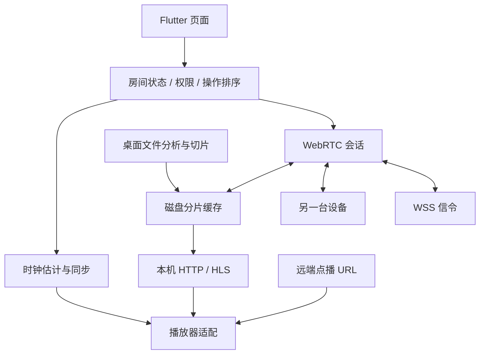

# 第一版技术架构

> 实施范围更新：用户已授权开始实现，首版覆盖 Windows/macOS/Linux/Android/iOS/Web。本文早期“仅设计”“桌面先行”“移动/Web 后续”及桌面停止条件由六端范围替代；平台专属媒体实现仍需逐端验证。执行约束与进度以 [IMPLEMENTATION.md](IMPLEMENTATION.md) 为准。

状态：待评审；范围以 [V1-PRD](V1-PRD.md) 为准。

## 1. 结构

一个 Flutter 工程按职责分模块，不预建微服务、插件市场或通用传输框架。共享模块包括模型、权限验证、协议、时钟和缓存调度；平台边界包括播放器、文件选择、安全密钥存储和进程启动。

| 模块 | 职责 |
|---|---|
| 界面 | 输入、状态呈现、可访问性，不直接修改房间状态 |
| 房间 | 验证权限，向房主提交请求，应用顺序提交与快照 |
| 同步 | 单调时钟映射、目标位置计算、漂移修正 |
| 连接 | WSS、WebRTC、握手、重连、发送背压 |
| 媒体 | URL 探测、本地分析、清单、切片和播放打开 |
| 缓存 | 分片校验、按需请求、容量驱逐、受保护窗口 |

## 2. 候选技术

Flutter/Dart；播放器优先验证 media_kit；DataChannel 优先验证 flutter_webrtc；桌面 FFmpeg/ffprobe 独立进程执行分析和免转码 remux；信令可用 Dart WebSocket 单进程服务。

这里是候选方案，尚未锁包版本。进入开发前必须验证三个桌面平台的 HLS/fMP4、倍速、seek、DTLS 指纹读取、背压及发布打包；并核对依赖和媒体工具分发许可。

## 3. 本地媒体链路

1. ffprobe 分析后检查兼容性，FFmpeg 按关键帧生成 init 与 fMP4 分片；不重编码，不保证固定片长。
2. 切片完成后计算 SHA-256，生成签名清单，将缓存标记为供片中。
3. 接收端按位置与缓冲窗口请求分片。整片验证通过后原子写入可用缓存。
4. 每台设备只在 loopback 上启动受控 HTTP 服务，提供本机 HLS 清单、init 和片段；播放器读取本机地址。
5. 下载调度在播放器请求前预取当前窗口。尚缺的片段请求有有界等待，超时返回可识别错误，由客户端进入缓冲/重试，不能伪造空片段或永久挂住。
6. 本机服务的端口和随机令牌每会话生成；只映射白名单缓存对象，禁止目录遍历与任意文件读取，退出关闭。

初始片长目标约 2–4 秒，实际依赖 GOP。第一版先完整准备后播放，不承诺选择文件后几秒即开播。全片 remux 需要额外磁盘空间，先检查可用空间；失败时清理临时输出且不修改原文件。

## 4. URL 链路

用户输入 URL 由媒体模块探测，禁止 shell 拼接；打开后由播放器直接请求源站。对 HLS 验证点播属性、init、音视频轨道与媒体段兼容性，重定向后仍校验 scheme。信令服务不探测和代理用户 URL。

列表中分享 URL 意味着房内观众可以看到该资源地址，包括查询令牌，添加前给出简明提示。来源可能变化，独立拉取无法仅凭同一个 URL 证明内容一致；时长和轨道检查只做异常检测，不声称内容哈希一致。

## 5. 同步与排序

房主使用进程单调时钟作为基准。客户端探测的 t1/t4 为本地发送/接收时间，t2/t3 为房主接收/发送时间：

- offset = ((t2 − t1) + (t3 − t4)) / 2。
- RTT = (t4 − t1) − (t3 − t2)。

入房先短时采样 5–8 次，优先低 RTT 样本，稳定后约 5 秒探测；避免把非对称延迟估计成精确测量。

播放状态包含 itemId、mode、positionMs、rate、effectiveAt、sessionId、seq。播放时目标位置 = positionMs + (估计房主当前时间 − effectiveAt) × rate；暂停固定位置。未来提交生效前继续旧状态，调度延迟则按当前目标追赶。

初始控制提前量 250–500 ms，结合 RTT 调整。房主每秒广播确认锚点，成员每秒回报状态。偏差 <50 ms 不动，50–250 ms 在用户倍速附近约 ±2% 修正，更大偏差 seek；缓冲期不追速，恢复后重新对齐。阈值均待实测。

请求去重、提交序号和缺号补发修复重传；列表修改和播放控制共用顺序。未确认的本地 UI 操作显示处理中，不提前当作全房已生效。

## 6. 下载与资源

M1 只从添加者获取，无多源调度。init 优先，之后按播放截止时间下载当前窗口；seek/换条目取消旧 requestId。每对连接三条可靠有序通道：ctrl、data-urgent、data-bulk，但共用底层拥塞资源。

片段拆为不大于协商消息限制的小块，初值约 16 KiB；发送缓冲达到高水位就暂停，低水位恢复。重传、待处理请求、乱序组装均设置上限，控制先于媒体。

缓存用磁盘，不整片驻留内存。实现前确定缓存容量默认值与最低空间阈值；运行中保护供片文件和当前播放窗口，其他缓存按最近使用驱逐。空间不足停止新增下载并提示清理，不删除源文件或正在使用的内容。

## 7. 服务与恢复

服务端只保存在线发现、房主身份绑定、邀请代次和消费记录，不保存媒体/播放状态；仅接受有界信令消息。配置 WSS、STUN、房间和连接限流，不部署产品 TURN 路径。

邀请原子接纳、绑定设备身份，房间人数由房主接纳记录最终约束。信令重启由房主重新登记并更换邀请代次。房主仍在原进程时保留 sessionId/seq；房主进程重启不恢复旧会话。

房主离线不选主；管理员请求显示暂不可控。恢复时以房主确认快照为准，重新估时。自动重试失败后提供手动重试；信令不可用时不保证能重新协商 ICE。

## 8. 未来跨平台边界

Android/iOS 需要验证本机媒体服务、解码与前后台恢复。Web 不复用 loopback 服务，需以 MSE 等浏览器能力接入同格式分片，并处理 codec、自动播放与 CORS。保留平台适配边界即可，第一版不编写这些平台实现。

当前MVP实现采用原始文件分块与校验：原生端通过本机HTTP Range桥接交给media_kit；Web通过Service Worker的Range响应交给浏览器播放器，点播HLS由已有播放器库处理。上段“不编写这些平台实现”为历史假设，已由当前跨平台实施替代。Web媒体桥接需要浏览器安全上下文；普通公网HTTP的限制仍应明确提示。

Web媒体会话的有效token由当前页面持有，SW的内存注册表用于快速拒绝不匹配请求。浏览器回收并重启SW后，每个meta/range/cancel查询仍携带请求token并交由该请求所属页面验证，避免把worker存活当作会话有效性的前提；错误token、其他client、已撤销会话均不能取得媒体。旧会话清理只能撤销自己的token，不能清除新会话的处理器。该生命周期修复正在专项验收，结果见[当前修复计划](CURRENT-REPAIR-PLAN.md)。

## 9. 依据

候选方案依据本轮已查阅的官方资料，版本与 API 在实施前再次核对：

- [media_kit](https://github.com/media-kit/media-kit)
- [flutter_webrtc](https://pub.dev/packages/flutter_webrtc)
- [FFmpeg 分片格式](https://www.ffmpeg.org/ffmpeg-formats.html)
- [DataChannel 大小与背压](https://developer.mozilla.org/en-US/docs/Web/API/WebRTC_API/Using_data_channels)
- [WebKit MediaSource](https://docs.webkit.org/Deep%20Dive/Modules/MediaSourceExtensions.html)

## 10. 全局语言与主题

遵循 [App 通用设置](APP-SETTINGS.md)：文案集中本地化，应用根节点统一选择明暗主题。浅色和深色主题色分别存储并构建对应语义配色；系统模式只选择生效主题，不覆盖用户颜色。偏好保存在本设备，切换不重建媒体和网络会话，不修改房间协议。

## 11. 复用与外观扩展约束

整个工程遵循 [项目开发原则](DEVELOPMENT-PRINCIPLES.md)：先评估已有能力与成熟库，再实现业务必要部分；上述模块是职责划分，不要求各自增加封装层。外观使用统一主题入口，后续支持开发和切换自定义方案，不复制业务；配置按外观方案与明暗模式隔离，详见 [外观要求](APP-SETTINGS.md)。
